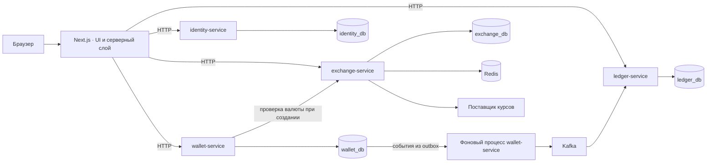

# Архитектура Fuchs Budget Platform

Один Git-репозиторий объединяет веб-приложение Next.js, сервисы на Go, их контракты и локальную инфраструктуру. У каждого приложения своя сборка. Изменение API, его реализации и веб-клиента можно проверить в одном pull request и выпускать поэтапно.

## Реализация

В `services/` находятся четыре Go-сервиса и процесс публикации `wallet-relay`. Их контракты OpenAPI лежат в каталогах `api/`. Docker Compose запускает отдельные базы PostgreSQL, Redis и Kafka. Веб-приложение находится в `apps/web`. Команды запуска, миграций и проверок описаны в [README](../README.md).

## Компоненты и данные



| Компонент | Чем владеет | За что отвечает |
| --- | --- | --- |
| `identity-service` | Пользователи и хеши паролей | Регистрация, вход, выдача JWT, получение профиля |
| `wallet-service` | Кошельки, их владельцы, валюта, баланс и исходный журнал операций | Создание и редактирование кошелька, пополнение, списание и история. Только этот сервис меняет баланс |
| `exchange-service` | Справочник валют, сохранённые курсы с источником и временем наблюдения | Добавление валюты, проверка её кода, периодическая загрузка курсов и выдача последнего известного значения. Redis кеширует чтение, при промахе сервис читает PostgreSQL |
| `ledger-service` | Производные данные для отчётов | Собирает статистику доходов и расходов по пользователю, периоду, кошельку и валюте. Обновляет отчёты по событиям о проведённых операциях |

Сервис обращается к чужим данным через контракт владельца. Идентификатор пользователя берётся из проверенного JWT. Каждый сервис ограничивает чтение и запись данных областью этого пользователя. При создании кошелька Wallet проверяет код в Exchange и сохраняет его как часть кошелька. Для уже открытого кошелька пополнение и списание используют сохранённую валюту и работают при недоступности Exchange. В первой версии редактирование меняет название кошелька. Валюта фиксируется при создании, чтобы вся история имела одну единицу измерения.

## Структура монорепозитория

```text
apps/
  web/                       # Next.js, TypeScript, package.json и package-lock.json
    app/                     # App Router, layouts, страницы и HTTP-обработчики
    src/                     # Модули интерфейса по Feature-Sliced Design
services/
  identity-service/
  wallet-service/
  exchange-service/
  ledger-service/
pkg/
  jwtmiddleware/             # Общая проверка токена для Go-сервисов
  logger/                    # Каталог общего модуля логирования
docs/
  architecture.md
go.work                      # Рабочая область Go-модулей
docker-compose.yml           # Состав локального окружения
README.md                    # Точка входа и команды разработки
```

Каждый Go-сервис сохраняет собственные `go.mod`, `main.go`, `internal/` и `migrations/`. Его HTTP-контракт хранится рядом в `api/openapi.yaml`. Внутри сервиса `router` связывает зависимости и маршруты, `handler` разбирает HTTP, `service` задаёт бизнес-правила и границы транзакций, `repository` выполняет запросы, `domain` описывает сущности. Сервисы подключаются к корневому `go.work` по мере появления кода. В `pkg/` выносятся общие технические пакеты. Модели кошелька и записи отчёта принадлежат разным сервисам и могут развиваться независимо.

## Денежная операция

1. Клиент передаёт Wallet идентификатор кошелька и положительную сумму. Веб-клиент создаёт ключ идемпотентности на одно действие и сохраняет его при повторной отправке. Для действующих клиентов v1 ключ вводится необязательным.
2. Wallet открывает транзакцию PostgreSQL, находит строку кошелька по `id` и `user_id` с `SELECT … FOR UPDATE`. После получения блокировки проверяет ключ повтора, точность суммы и доступный остаток. Два одновременных списания с одного кошелька проверяют остаток последовательно.
3. В той же транзакции Wallet обновляет баланс и добавляет запись в журнал. Для запросов с ключом сохраняет его, параметры и результат под уникальным ограничением на кошелёк и ключ. Повтор с теми же параметрами возвращает исходный результат, с другими — конфликт. Любая ошибка до фиксации откатывает все записи.
4. С подключением статистики Wallet также пишет событие в таблицу исходящих событий (outbox) в той же транзакции. Клиент получает успех после фиксации в PostgreSQL. Фоновый процесс публикует событие в Kafka и отмечает отправку после подтверждения брокера.

**Точность.** PostgreSQL хранит суммы в `NUMERIC(18,2)`. Go читает входное JSON-число как десятичное значение без промежуточного `float64`. Перед записью Wallet отклоняет суммы, превышающие точность кошелька. Допустимая точность новой валюты ограничена двумя знаками. В v1 сохранены числовой JSON-формат и суммы существующих кошельков. Существующие кошельки сохраняют точность до двух знаков.

**Отчёты.** Триггер Wallet добавляет событие в outbox в той же транзакции, что и запись журнала. Событие содержит версию схемы, ID операции, пользователя и кошелька, тип операции, сумму, валюту и время проведения. Ledger учитывает ID операции и обновляет агрегат одной атомарной командой PostgreSQL, затем подтверждает обработку в Kafka. Миграция `00004` добавляет существующие операции с исходными ID. Дашборд читает актуальные балансы у Wallet и показывает время обработки последней операции в отчёте. Итоги разделены по валютам, дни учитываются в UTC.

## Фронтенд

В `apps/web` серверный слой Next.js связывает интерфейс с Go API. Серверные страницы вызывают типизированные клиенты напрямую. Интерактивные формы обращаются к обработчикам Next.js на том же origin. Эти обработчики передают JWT в `Authorization: Bearer` нужному сервису. Правила владения кошельком, проверки остатка и записи операции исполняет Wallet.

| Каталог | Содержимое |
| --- | --- |
| `app/[locale]/` | Тонкие точки входа для русских и английских маршрутов. Группа `(public)` содержит вход и регистрацию, `(protected)` объединяет дашборд, кошельки и курсы |
| `app/api/` | Обработчики сессии и запросов браузера к серверу Next.js |
| `src/views/` | Слой страниц FSD под именем `views`, чтобы Next.js не распознал его как Pages Router. Сборка дашборда, форм входа и регистрации, курсов и страниц кошелька |
| `src/widgets/` | Список кошельков, сводка расходов, таблица курсов |
| `src/features/` | Вход, регистрация, создание и редактирование кошелька, запись операции, добавление валюты, переключение языка |
| `src/entities/` | Модели пользователя, кошелька, операции и валютного курса, преобразование API-ответов в данные интерфейса |
| `src/shared/` | HTTP-транспорт, типы из OpenAPI, базовые элементы UI, словари RU/EN и форматирование |

Зависимости идут от маршрутов к страницам, затем к виджетам, сценариям, сущностям и общему коду. Каждый модуль предоставляет публичные экспорты. Серверный код с доступом к токену импортируется только из серверных точек входа.

**Сессия.** После регистрации пользователь входит через Identity. При входе Next.js получает `access_token` и кладёт его в cookie с `HttpOnly`, `SameSite=Lax` и `Secure` при HTTPS. Срок cookie ограничен сроком токена. Для изменяющих запросов из браузера обработчики проверяют origin. При истечении сессии приложение возвращает пользователя на страницу входа, при выходе удаляет cookie. Персональные ответы исключаются из общего кеша.

**Маршруты и адаптация.** Для каждой локали предусмотрены `/ru` или `/en` (дашборд), а внутри неё — `login`, `register`, `rates`, `wallets/new` и `wallets/[id]/edit`. Переключатель языка сохраняет текущий экран. Даты и суммы форматируются по выбранной локали, сумма всегда сопровождается валютой кошелька. На телефоне кошельки и сводки идут одной колонкой, на планшете карточки образуют сетку, на десктопе список кошельков и статистика видны рядом. Сбой загрузки статистики или курсов обрабатывает соответствующий виджет, список кошельков остаётся доступным.

## Порядок реализации и проверки

1. **Зафиксировать базовый API и исправить запись денег.** Описать существующие маршруты `/api/v1` Identity и Wallet по их фактическим ответам. Перевести запись операций на одну транзакцию. Проверить на PostgreSQL откат при ошибке записи и два конкурентных списания, сумма которых превышает остаток. Проверить повтор запроса и доступ к чужому кошельку.
2. **Собрать первый пользовательский сценарий.** Добавить получение и редактирование кошелька по ID, чтение истории и нужные OpenAPI-контракты. Реализовать регистрацию, вход, дашборд, создание и редактирование кошелька, пополнение и списание. Сквозной тест проходит этот путь через веб-интерфейс и сверяет итоговый баланс.
3. **Подключить валюты и курсы.** Реализовать Exchange, заполнить справочник в том числе кодами уже созданных кошельков, затем включить проверку валюты в Wallet. При сбое поставщика экран курсов показывает последнее сохранённое значение с датой либо состояние отсутствия данных.
4. **Добавить статистику.** Подключить outbox, публикацию и потребителя Ledger. Проверить задержку брокера, повторную доставку, загрузку истории и согласованность отчёта с исходным журналом.

Для каждого изменения CI проверяет затронутые Go-модули и их потребителей, миграции на PostgreSQL, совместимость OpenAPI и сборку использующих контракт приложений. Для веб-приложения нужны проверка типов, сборка Next.js и тесты ключевых сценариев на трёх размерах экрана, включая смену языка и истечение сессии. Миграции Goose добавляются в сервисе-владельце. Несовместимую схему вводят поэтапно с переносом данных до удаления старых полей. По мере реализации команды запуска, миграций и проверок добавляются в корневой README.
